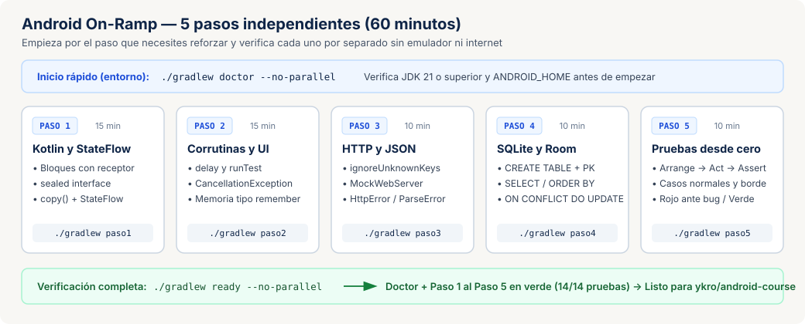

# Android On-Ramp — Soluciones de referencia

Este repositorio contiene las soluciones completas y verificadas (`11/11` pruebas en verde) de [ykro/android-onramp](https://github.com/ykro/android-onramp). Úsalo para comparar tu trabajo y entender qué se cambió en cada uno de los cinco pasos independientes antes de iniciar [ykro/android-course](https://github.com/ykro/android-course).



## Los 5 pasos (independientes)

| Paso | Tiempo | Enfoque | Verificación | Guía |
| --- | --- | --- | --- | --- |
| Paso 1 | 10 min | Entorno: JDK 21 o superior y `ANDROID_HOME` | `./gradlew paso1 --no-parallel` | [steps/01-entorno/README.md](steps/01-entorno/README.md) |
| Paso 2 | 15 min | Trailing lambdas con receptor, `sealed interface` y `StateFlow` inmutable | `./gradlew paso2 --no-parallel` | [steps/02-kotlin-y-stateflow/README.md](steps/02-kotlin-y-stateflow/README.md) |
| Paso 3 | 15 min | `suspend`/`delay` con reloj virtual, `CancellationException` y `remember` | `./gradlew paso3 --no-parallel` | [steps/03-corrutinas-y-ui/README.md](steps/03-corrutinas-y-ui/README.md) |
| Paso 4 | 10 min | `kotlinx.serialization`, `MockWebServer` y errores HTTP o de parseo | `./gradlew paso4 --no-parallel` | [steps/04-http-json/README.md](steps/04-http-json/README.md) |
| Paso 5 | 10 min | SQLite (`CREATE TABLE`, `SELECT/ORDER BY`, `ON CONFLICT DO UPDATE`) y Room 3 | `./gradlew paso5 --no-parallel` | [steps/05-sql-y-upsert/README.md](steps/05-sql-y-upsert/README.md) |

## Inicio rápido

1. Exporta `ANDROID_HOME` si aún no está definido en tu terminal (por ejemplo en macOS: `export ANDROID_HOME="$HOME/Library/Android/sdk"`).
2. Ejecuta la verificación completa (`paso1` a `paso5`, 11 pruebas):

```bash
./gradlew ready --no-parallel
```

3. También puedes verificar cada paso por separado:

```bash
./gradlew paso1 --no-parallel
./gradlew paso2 --no-parallel
./gradlew paso3 --no-parallel
./gradlew paso4 --no-parallel
./gradlew paso5 --no-parallel
```

## Dónde ver la solución de cada paso

| Paso | Criterio | Qué se cambió y por qué | Archivo de solución |
| --- | --- | --- | --- |
| Paso 1 | `CA-1.1` | Verifica que JDK 21 o superior y `ANDROID_HOME` con al menos una plataforma instalada estén listos antes de programar. | [m0-doctor/build.gradle.kts](m0-doctor/build.gradle.kts) |
| Paso 2 | `CA-2.1` | `miniColumn` crea `ColumnScope()`, ejecuta `scope.content()` y devuelve `scope.buildLines()` para recolectar textos en orden. | [m1-kotlin-dsl-estado/src/main/kotlin/onramp/m1/DslBuilders.kt](m1-kotlin-dsl-estado/src/main/kotlin/onramp/m1/DslBuilders.kt) |
| Paso 2 | `CA-2.2` | `miniModule` crea `ModuleScope()`, ejecuta `scope.definitions()` y devuelve el contenedor con fábricas `single` cacheadas. | [m1-kotlin-dsl-estado/src/main/kotlin/onramp/m1/DslBuilders.kt](m1-kotlin-dsl-estado/src/main/kotlin/onramp/m1/DslBuilders.kt) |
| Paso 2 | `CA-2.3` | `renderOrderBanner` usa un `when` exhaustivo sin `else` sobre `OrderBannerState`, distinguiendo singular y plural en `Preparing`. | [m1-kotlin-dsl-estado/src/main/kotlin/onramp/m1/OrderState.kt](m1-kotlin-dsl-estado/src/main/kotlin/onramp/m1/OrderState.kt) |
| Paso 2 | `CA-2.4` | `OrderBoardState` cambia `MutableList` por `List` de solo lectura y `OrderBoard` usa `_state.update { it.copy(...) }` para que `StateFlow` detecte cada cambio y emita a la pantalla. | [m1-kotlin-dsl-estado/src/main/kotlin/onramp/m1/OrderState.kt](m1-kotlin-dsl-estado/src/main/kotlin/onramp/m1/OrderState.kt) |
| Paso 3 | `CA-3.1` | `countdownTicks` usa `flow { ... }` y `delay(stepMs)` en lugar de `Thread.sleep`, de modo que `runTest` adelanta el reloj virtual al instante. | [m2-corrutinas-y-ui/src/main/kotlin/onramp/m2/CoroutinesAndUi.kt](m2-corrutinas-y-ui/src/main/kotlin/onramp/m2/CoroutinesAndUi.kt) |
| Paso 3 | `CA-3.2` | `runSafely` captura y relanza `CancellationException` antes de capturar `Exception`, evitando que una pantalla cerrada deje corrutinas activas. | [m2-corrutinas-y-ui/src/main/kotlin/onramp/m2/CoroutinesAndUi.kt](m2-corrutinas-y-ui/src/main/kotlin/onramp/m2/CoroutinesAndUi.kt) |
| Paso 3 | `CA-3.3` | `renderStudyCounter` sustituye `var count = 0` por `memory.remember("sessions") { 0 }` para conservar el contador entre redibujos sucesivos. | [m2-corrutinas-y-ui/src/main/kotlin/onramp/m2/CoroutinesAndUi.kt](m2-corrutinas-y-ui/src/main/kotlin/onramp/m2/CoroutinesAndUi.kt) |
| Paso 4 | `CA-4.1` | `BookApiClient` configura `Json { ignoreUnknownKeys = true }` para decodificar `List<BookDto>` sin fallar cuando el servidor envía campos extra. | [m3-http-y-sql/src/main/kotlin/onramp/m3/BookApiClient.kt](m3-http-y-sql/src/main/kotlin/onramp/m3/BookApiClient.kt) |
| Paso 4 | `CA-4.2` | `fetchBooks()` revisa `!response.isSuccessful` para devolver `ApiResult.HttpError(response.code)` y atrapa `SerializationException` para devolver `ApiResult.ParseError`. | [m3-http-y-sql/src/main/kotlin/onramp/m3/BookApiClient.kt](m3-http-y-sql/src/main/kotlin/onramp/m3/BookApiClient.kt) |
| Paso 5 | `CA-5.1` | `BookDatabase.createSchema()` crea la tabla `books` con `PRIMARY KEY` y valores por defecto, y `findFavoritesOrderedByTitle()` filtra `favorite = 1` ordenado por `title ASC`. | [m3-http-y-sql/src/main/kotlin/onramp/m3/BookDatabase.kt](m3-http-y-sql/src/main/kotlin/onramp/m3/BookDatabase.kt) |
| Paso 5 | `CA-5.2` | `syncFromApi()` reemplaza `INSERT OR REPLACE` por `ON CONFLICT(id) DO UPDATE SET title = excluded.title, author = excluded.author` para actualizar sin borrar `favorite` ni `local_note`. | [m3-http-y-sql/src/main/kotlin/onramp/m3/BookDatabase.kt](m3-http-y-sql/src/main/kotlin/onramp/m3/BookDatabase.kt) |

## Recursos y uso de IA

- Si quieres repasar algún término técnico, consulta el [glosario](docs/glosario.md).
- Este repositorio conserva [AGENTS.md](AGENTS.md) en **modo tutor socrático**: puedes pedirle a cualquier asistente de IA que te explique una solución o te proponga un ejemplo alternativo.
- Índice general de todos los on-ramps: [ykro/courses-onramp](https://github.com/ykro/courses-onramp).
- Repositorio inicial (para practicar): [ykro/android-onramp](https://github.com/ykro/android-onramp).
- Curso principal: [ykro/android-course](https://github.com/ykro/android-course).
