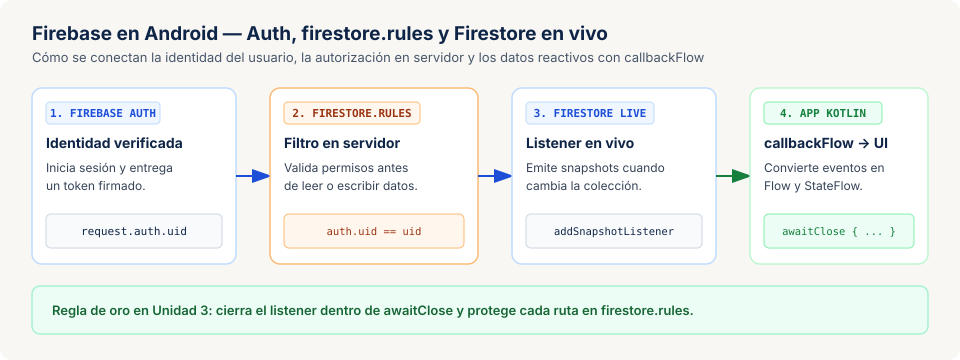

# Guía visual corta: Firebase en Android (Auth, Firestore y `firestore.rules`)



En la Unidad 3 de [ykro/android-course](https://github.com/ykro/android-course) conectarás tu app Android a tres piezas de Firebase que trabajan juntas sobre lo que ya practicaste con `Flow` y estado reactivo:

1. **[Firebase Authentication](https://firebase.google.com/docs/auth):** identifica al usuario que usa la app y genera un token firmado con su `uid`. Tu código nunca confía en un `userId` escrito a mano desde la pantalla; Firebase adjunta la identidad verificada en cada petición.
2. **[Cloud Firestore en tiempo real](https://firebase.google.com/docs/firestore/query-data/listen) con [`callbackFlow`](https://kotlinlang.org/api/kotlinx.coroutines/kotlinx-coroutines-core/kotlinx.coroutines.flow/callback-flow.html):** Firestore avisa por medio de un listener (`addSnapshotListener`) cada vez que cambia un documento o una colección. En Kotlin envolvemos ese listener dentro de `callbackFlow { ... }` para convertirlo en un `Flow` normal que tu `ViewModel` recolecta como `StateFlow`, y cerramos el listener dentro de `awaitClose { registration.remove() }` para no filtrar memoria cuando el usuario sale de la pantalla.
3. **[Reglas de seguridad (`firestore.rules`)](https://firebase.google.com/docs/firestore/security/get-started):** corren en los servidores de Firebase antes de leer o escribir cualquier documento. Incluso si alguien modifica la app cliente, las reglas bloquean accesos sin sesión o de otros usuarios.

## Ejemplo mínimo de `callbackFlow` y `firestore.rules`

```kotlin
fun observeNotes(uid: String): Flow<List<Note>> = callbackFlow {
    val registration = db.collection("users").document(uid)
        .collection("notes")
        .addSnapshotListener { snapshot, error ->
            if (error != null) {
                close(error)
                return@addSnapshotListener
            }
            val notes = snapshot?.documents?.mapNotNull { it.toObject(Note::class.java) }.orEmpty()
            trySend(notes)
        }
    awaitClose { registration.remove() }
}
```

```javascript
rules_version = '2';
service cloud.firestore {
  match /databases/{database}/documents {
    match /users/{uid}/notes/{noteId} {
      allow read: if request.auth != null && request.auth.uid == uid;
      allow create, update, delete: if request.auth != null && request.auth.uid == uid;
    }
  }
}
```

## Ideas clave para recordar al llegar a la Unidad 3

- **Siempre cierra el listener:** sin `awaitClose { registration.remove() }`, la app sigue escuchando cambios de red aunque la pantalla ya no exista.
- **La seguridad vive en `firestore.rules`, no en la UI:** ocultar un botón en Compose mejora la experiencia, pero solo `request.auth.uid == uid` protege los datos en el servidor.
- **No necesitas cuenta de Firebase en este on-ramp:** esta guía es solo lectura preparatoria; los 7 pasos del repositorio corren 100 % en local sin internet.

Consulta también el [glosario](glosario.md) o vuelve al [README principal](../README.md).
