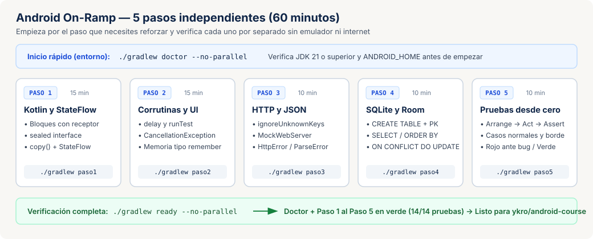

# Paso 1. Entorno (JDK 21 y `ANDROID_HOME`)



## Por qué importa

Antes de escribir código en Kotlin o abrir Android Studio, tu computadora necesita dos piezas bien configuradas: [JDK 21 (Eclipse Temurin)](https://adoptium.net/temurin/releases/?version=21) para ejecutar Gradle y las pruebas, y la variable de entorno [`ANDROID_HOME`](https://developer.android.com/tools/variables#envar) apuntando a la carpeta del Android SDK. Resolver esto en diez minutos evita bloqueos al entrar a [ykro/android-course](https://github.com/ykro/android-course).

## Qué se construye

En este paso no editas código fuente: ejecutas la tarea de diagnóstico definida en [m0-doctor/build.gradle.kts](../../m0-doctor/build.gradle.kts) y corriges cualquier requisito que salga como `[FALTA]`.

- **Si falta JDK 21:** instala [Eclipse Temurin 21](https://adoptium.net/temurin/releases/?version=21) (o `brew install openjdk@21` en macOS) y confirma con `java -version`.
- **Si falta `ANDROID_HOME`:** abre Android Studio, entra a **Settings -> Languages & Frameworks -> Android SDK**, instala una plataforma reciente y exporta la variable en tu terminal:
  - macOS: `export ANDROID_HOME="$HOME/Library/Android/sdk"`
  - Linux: `export ANDROID_HOME="$HOME/Android/Sdk"`
  - Windows (PowerShell): `$env:ANDROID_HOME = "$env:LOCALAPPDATA\Android\Sdk"`

## Criterios de aceptación

- `CA-1.1` [auto] `./gradlew paso1 --no-parallel` detecta JDK 21 o superior y una carpeta válida en `ANDROID_HOME` con al menos una plataforma instalada, y termina con `[OK] Entorno listo para trabajar.`.

## Cómo verificar

Desde la raíz del repositorio ejecuta:

```bash
./gradlew paso1 --no-parallel
```

También funciona el alias `./gradlew doctor --no-parallel`. Puedes continuar al [Paso 2: Kotlin y StateFlow](../02-kotlin-y-stateflow/README.md) o saltar directo al paso que necesites reforzar. Si algún término es nuevo, consulta el [glosario](../../docs/glosario.md).
