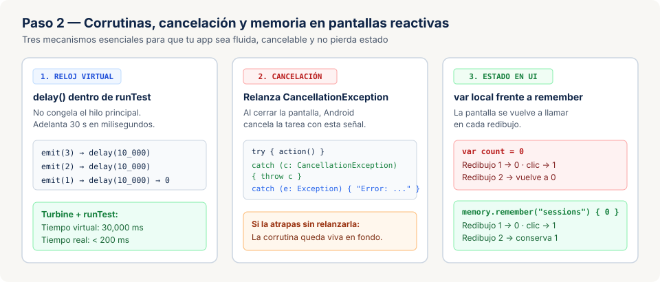

# Paso 2. Corrutinas, cancelación y estado en UI



Este paso toma unos 25 minutos.

## Antes de empezar

1. Si el hilo que dibuja la pantalla se queda esperando tres segundos a que responda un servidor, ¿qué ve la persona que usa la app?
2. Cuando alguien cierra una pantalla a medio cargar, ¿qué debería pasar con la descarga que esa pantalla había empezado?
3. Si una función que dibuja la pantalla declara `var count = 0` y se vuelve a llamar en cada redibujo, ¿cuánto vale `count` al inicio de cada llamada?

## Por qué importa

En Android la interfaz corre en el hilo principal; si lo bloqueas con `Thread.sleep`, la pantalla se congela. Las [corrutinas](https://kotlinlang.org/docs/coroutines-basics.html) usan `suspend` y `delay` para pausar solo la tarea. En los tests, [`runTest`](https://kotlinlang.org/api/kotlinx.coroutines/kotlinx-coroutines-test/kotlinx.coroutines.test/run-test.html) usa un reloj virtual que adelanta un `delay(10_000L)` al instante. Dos errores frecuentes al empezar son atrapar la [cancelación](https://kotlinlang.org/docs/cancellation-and-timeouts.html) con un `catch (e: Exception)`, que deja tareas vivas cuando la persona cierra la pantalla, y guardar estado en una variable local que vuelve a cero en cada redibujo en lugar de usar [`remember` en Compose](https://developer.android.com/develop/ui/compose/state#state-in-composables).

## Lo mínimo que necesitas saber

- **`suspend`.** Marca una función que puede pausarse sin bloquear el hilo. Solo se puede llamar desde otra función `suspend` o desde una corrutina.
- **`Flow`.** Una secuencia de valores que llegan con el tiempo. Se construye con `flow { emit(valor) }` y alguien lo recolecta con `collect`.
- **Cancelación.** Cuando una corrutina se cancela, Kotlin lanza `CancellationException` dentro de ella para detenerla. Si la atrapas y no la vuelves a lanzar, la corrutina sigue viva.
- **Recomposición.** En Compose, cada función de pantalla se vuelve a ejecutar cuando cambia su estado. Lo que deba sobrevivir entre ejecuciones tiene que vivir fuera de la función; `remember` lo guarda por ti. En este paso, `UiMemory` simula ese mecanismo.

## Qué vas a hacer

- **Leer.** Abre [CoroutinesAndUi.kt](../../m2-corrutinas-y-ui/src/main/kotlin/onramp/m2/CoroutinesAndUi.kt) y [Module2Test.kt](../../m2-corrutinas-y-ui/src/test/kotlin/onramp/m2/Module2Test.kt). En el test de `countdownTicks`, ubica qué parte mide el tiempo real.
- **Debuguear.** Corre `./gradlew paso2 --no-parallel`. Para el ejercicio 3, sigue a mano qué vale `count` en la primera llamada, después de `onIncrement()` y en la segunda llamada a `renderStudyCounter`.
- **Escribir.** Resuelve los tres ejercicios. No uses `Thread.sleep` en ningún lado.

## Criterios de aceptación

- `CA-2.1` `countdownTicks(from = 3, stepMs = 10_000L)` emite `3, 2, 1, 0` y el test termina en menos de 2 segundos reales.
- `CA-2.2` `runSafely` devuelve `Error: sin internet` ante un `IllegalStateException("sin internet")` y deja pasar la cancelación del `Job`.
- `CA-2.3` `renderStudyCounter` conserva el contador entre redibujos con la misma `UiMemory` y lo reinicia con `onReset()`.

## Al terminar

1. Si cambias `delay(stepMs)` por `Thread.sleep(stepMs)`, ¿qué pasa con el tiempo del test de `CA-2.1`? ¿Por qué el reloj virtual no lo puede adelantar?
2. En `runSafely`, ¿qué pasaría si el `catch (e: Exception)` fuera antes que el de `CancellationException`?
3. Con la misma `UiMemory`, dos llamadas a `renderStudyCounter` comparten contador. ¿Qué pasaría con dos `UiMemory` distintas? ¿A qué equivale eso en una app?
4. Explica en tres líneas, con tus palabras, qué cambiaste y por qué. Si no puedes, vuelve a la pista 1 antes de seguir.

## Cómo verificar

```bash
./gradlew paso2 --no-parallel
```

Si te trabas, abre la [pista 1](hints/1.md). Cada pista da un poco más que la anterior; la pista 3 trae un esqueleto, nunca la respuesta completa.

## Respuestas de autoevaluación

1. El test tarda unos 30 segundos reales y falla el límite de 2 segundos. `Thread.sleep` bloquea el hilo de verdad y no pasa por el planificador de corrutinas, así que el reloj virtual no se entera de que hay una espera.
2. La cancelación caería en el `catch` genérico, `runSafely` devolvería un texto de error y la corrutina seguiría corriendo aunque la pantalla ya no exista.
3. Cada `UiMemory` tendría su propio contador, empezando en cero. Equivale a dos pantallas distintas, o a la misma pantalla abierta de nuevo después de cerrarla; `remember` vive mientras la pantalla siga en la composición.
4. Respuesta personal. Debe mencionar `delay` contra `Thread.sleep`, relanzar `CancellationException` y guardar el estado fuera de la función que se vuelve a ejecutar.
