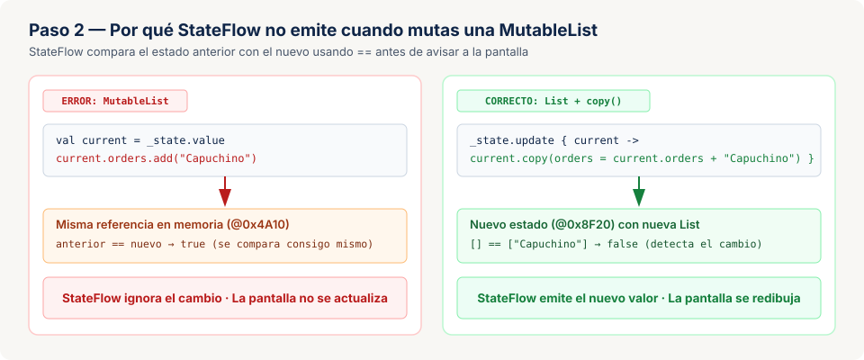

# Paso 2. Kotlin, bloques DSL y `StateFlow`



## Por qué importa

En Jetpack Compose y Koin verás bloques como `Column { Text("Hola") }` y `module { single { ... } }` desde el primer día. Esa sintaxis combina dos reglas normales de Kotlin: [trailing lambdas](https://kotlinlang.org/docs/lambdas.html#passing-trailing-lambdas) y [funciones con receptor](https://kotlinlang.org/docs/lambdas.html#function-literals-with-receiver).

Al mismo tiempo, casi todas las pantallas modernas en Android leen su estado desde un [`StateFlow`](https://developer.android.com/kotlin/flow/stateflow-and-sharedflow). `StateFlow` compara el estado anterior con el nuevo usando `==`. Si mutas una `MutableList` dentro de una [`data class`](https://kotlinlang.org/docs/data-classes.html), ambos estados apuntan a la misma lista en memoria y la pantalla nunca se entera del cambio. Usar una `List` de solo lectura, [`copy()`](https://kotlinlang.org/docs/data-classes.html#copying) y [`sealed interface`](https://kotlinlang.org/docs/sealed-classes.html) con [`when`](https://kotlinlang.org/docs/control-flow.html#when-expressions-and-statements) evita esa clase de errores.

## Qué se construye

- En [DslBuilders.kt](../../m1-kotlin-dsl-estado/src/main/kotlin/onramp/m1/DslBuilders.kt):
  - `miniColumn`: crea `ColumnScope()`, ejecuta `scope.content()` y devuelve `scope.buildLines()`.
  - `miniModule`: crea `ModuleScope()`, ejecuta `scope.definitions()` y devuelve `scope.buildContainer()`.
- En [OrderState.kt](../../m1-kotlin-dsl-estado/src/main/kotlin/onramp/m1/OrderState.kt):
  - `renderOrderBanner`: cubre las cuatro ramas de `OrderBannerState` (`Empty`, `Preparing`, `Ready`, `Failed`) con `when` exhaustivo y sin `else`.
  - `OrderBoardState` y `OrderBoard`: cambia `MutableList<String>` por `List<String> = emptyList()` y actualiza `_state` con `_state.update { current -> current.copy(...) }` usando `current.orders + clean` y `current.orders.drop(1)`.

## Criterios de aceptación

- `CA-2.1` [auto] `miniColumn` recolecta los textos en orden mediante un bloque con receptor `ColumnScope`.
- `CA-2.2` [auto] `miniModule` registra fábricas `single` y devuelve siempre la misma instancia en llamadas sucesivas a `container.get(...)`.
- `CA-2.3` [auto] `renderOrderBanner` cubre las cuatro subclases de la `sealed interface` `OrderBannerState` (distinguiendo singular y plural en `Preparing`) sin rama `else`.
- `CA-2.4` [auto] `OrderBoard` emite un estado nuevo en `StateFlow` cada vez que agregas o quitas un pedido, verificado con Turbine en [Module1Test.kt](../../m1-kotlin-dsl-estado/src/test/kotlin/onramp/m1/Module1Test.kt).

## Cómo verificar

Este paso es completamente independiente. Desde la raíz del repositorio ejecuta sus 4 pruebas:

```bash
./gradlew paso2 --no-parallel
```

Cuando las 4 pruebas terminen en verde, avanza al [Paso 3: Corrutinas y estado en UI](../03-corrutinas-y-ui/README.md).
