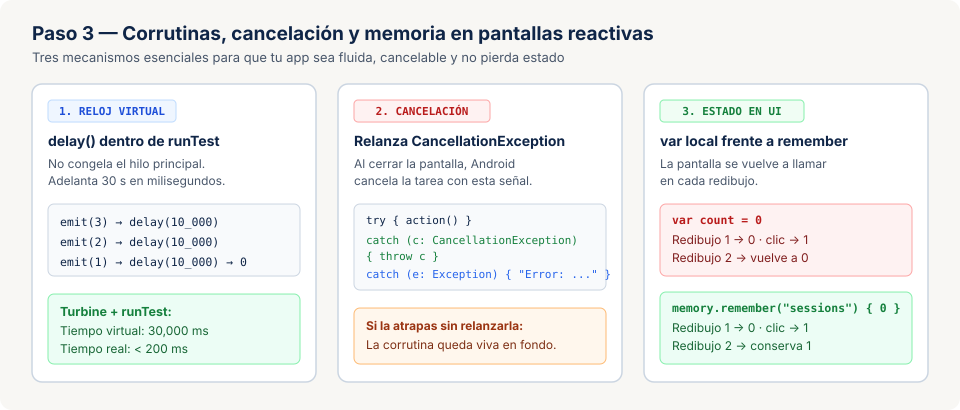

# Paso 3. Corrutinas, cancelación y estado en UI



## Por qué importa

En Android la interfaz corre en el hilo principal. Si bloqueas ese hilo con `Thread.sleep`, la pantalla se congela. Las [corrutinas en Kotlin](https://kotlinlang.org/docs/coroutines-basics.html) resuelven esto con `suspend` y `delay`, que pausan solo la tarea y dejan libre el hilo. Además, al probar con [`runTest`](https://kotlinlang.org/api/kotlinx.coroutines/kotlinx-coroutines-test/kotlinx.coroutines.test/run-test.html) y [Turbine](https://github.com/cashapp/turbine), el reloj virtual adelanta `delay(10_000L)` al instante.

Otros dos errores frecuentes al iniciar con Android son tragar [`CancellationException`](https://kotlinlang.org/docs/cancellation-and-timeouts.html) dentro de un `catch (e: Exception)` (dejando tareas vivas cuando el usuario cierra la pantalla) y guardar estado en una variable local `var count = 0` que vuelve a cero en cada redibujo en lugar de usar [`remember` en Jetpack Compose](https://developer.android.com/develop/ui/compose/state#state-in-composables).

## Qué se construye

En [CoroutinesAndUi.kt](../../m2-corrutinas-y-ui/src/main/kotlin/onramp/m2/CoroutinesAndUi.kt):

- `countdownTicks(from, stepMs)`: devuelve un `flow { ... }` que emite desde `from` hasta `0` usando `delay(stepMs)` entre números (sin `Thread.sleep`), y sale de inmediato si `from < 0`.
- `runSafely(action)`: ejecuta `action()` dentro de `try`, relanza `CancellationException` en el primer `catch` y convierte otros `Exception` en `"Error: ${error.message ?: "desconocido"}"`.
- `renderStudyCounter(memory)`: reemplaza `var count = 0` por `memory.remember("sessions") { 0 }`, lee `sessions.value` para armar `label` y actualiza `sessions.value` en `onIncrement` y `onReset`.

## Criterios de aceptación

- `CA-3.1` [auto] `countdownTicks(from = 3, stepMs = 10_000L)` emite `3, 2, 1, 0` y termina en menos de 2 segundos reales bajo `runTest` usando reloj virtual.
- `CA-3.2` [auto] `runSafely` devuelve `"Error: sin internet"` ante un `IllegalStateException` y siempre relanza `CancellationException` cuando el `Job` se cancela.
- `CA-3.3` [auto] `renderStudyCounter` conserva el contador entre redibujos sucesivos con la misma instancia de `UiMemory` y lo reinicia con `onReset()`, verificado en [Module2Test.kt](../../m2-corrutinas-y-ui/src/test/kotlin/onramp/m2/Module2Test.kt).

## Cómo verificar

Este paso es completamente independiente. Desde la raíz del repositorio ejecuta sus 3 pruebas:

```bash
./gradlew paso3 --no-parallel
```

Cuando las 3 pruebas terminen en verde, avanza al [Paso 4: HTTP y JSON tolerante](../04-http-json/README.md).
