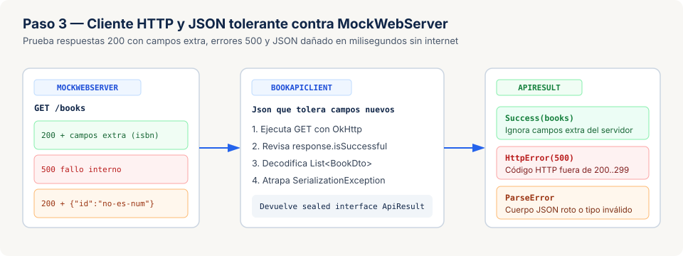

# Paso 3. HTTP y JSON tolerante con `MockWebServer`



## Por qué importa

Una app real consume APIs que cambian con el tiempo: agregan campos nuevos sin avisar, devuelven errores `500` cuando el servidor falla o entregan cuerpos con JSON dañado. Configurar [`Json { ignoreUnknownKeys = true }`](https://github.com/Kotlin/kotlinx.serialization/blob/master/docs/json.md#ignoring-unknown-keys) en `kotlinx.serialization` evita que un campo extra rompa tu app, y usar [OkHttp `MockWebServer`](https://github.com/square/okhttp/tree/master/mockwebserver) te permite probar respuestas `200`, `500` y JSON inválido en milisegundos sin depender de internet.

## Qué se construye

En [BookApiClient.kt](../../m3-http-y-sql/src/main/kotlin/onramp/m3/BookApiClient.kt):

- Define `private val json = Json { ignoreUnknownKeys = true }`.
- En `fetchBooks()`:
  - Construye la petición GET hacia `"${baseUrl.trimEnd('/')}/books"` con OkHttp.
  - Si `!response.isSuccessful`, devuelve `ApiResult.HttpError(response.code)`.
  - Lee `response.body.string()` y decodifica `List<BookDto>` dentro de `try/catch (SerializationException)` para devolver `ApiResult.Success(books)` o `ApiResult.ParseError`.

## Criterios de aceptación

- `CA-3.1` [auto] `BookApiClient.fetchBooks()` decodifica respuestas `200` de `MockWebServer` ignorando campos extra (`pages`, `isbn`, `edition`).
- `CA-3.2` [auto] `BookApiClient.fetchBooks()` devuelve `ApiResult.HttpError(500)` ante un `500` y `ApiResult.ParseError` ante JSON inválido, verificado en [BookApiClientTest.kt](../../m3-http-y-sql/src/test/kotlin/onramp/m3/BookApiClientTest.kt).

## Cómo verificar

Este paso es completamente independiente (no necesita que hayas resuelto el Paso 4). Desde la raíz del repositorio ejecuta sus 2 pruebas:

```bash
./gradlew paso3 --no-parallel
```

Cuando las 2 pruebas terminen en verde, avanza al [Paso 4: SQLite, upsert y puente hacia Room 3](../04-sql-y-upsert/README.md).
