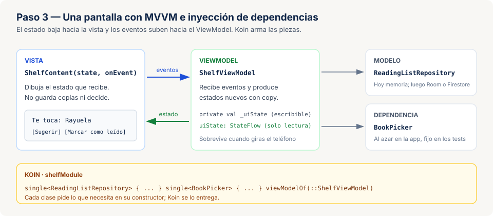

# Paso 3. UI declarativa, ViewModel (MVVM) e inyección de dependencias



Este paso toma unos 75 minutos.

## Antes de empezar

1. En Java con Swing, si cambia el número de libros pendientes, ¿qué código tienes que escribir para que la etiqueta de la pantalla muestre el número nuevo? ¿Qué pasa si se te olvida una etiqueta?
2. Una clase crea adentro su propio `Random()`. ¿Cómo escribirías un test que sepa de antemano qué número va a salir?
3. Si la pantalla y la lógica viven en la misma función, ¿cómo probarías la lógica sin dibujar la pantalla?

## Por qué importa

Desde la Unidad 1 del curso, cada pantalla tiene tres piezas. Un composable que dibuja, un `ViewModel` que guarda el estado y decide qué hacer con cada toque, y un repositorio que trae los datos. Koin arma esas piezas. Por ejemplo, `DiceArenaViewModel` recibe un `DiceRoller` en su constructor para que los tests sepan qué número sale en cada dado, y `DiceArenaScreen` solo le pasa el estado a `DiceArenaContent`. Este paso es esa misma arquitectura en pequeño, con un estante de libros pendientes. Si entiendes por qué cada pieza está separada, el código del curso deja de verse como magia.

## Lo mínimo que necesitas saber

- **UI imperativa contra UI declarativa.** En Swing o en las vistas clásicas de Android guardas una referencia a cada etiqueta y llamas `label.setText(...)` cada vez que cambia un dato; si olvidas una, la pantalla miente. En Compose escribes una función que recibe el estado y describe cómo se ve la pantalla con ese estado. Cuando el estado cambia, Compose vuelve a llamar la función. La pantalla es una función del estado y nunca la modificas a mano.
- **Estado hacia abajo, eventos hacia arriba.** `ShelfContent` recibe el estado y una función `onEvent`. No decide nada, solo dibuja y avisa «tocaron Sugerir». A esto se le llama *state hoisting*, y deja una sola fuente de verdad. Si el composable copiara su parámetro en un `remember`, habría dos copias y solo una se actualizaría. Un composable así se prueba pasándole cualquier estado, sin ViewModel.
- **MVVM.** *Model, View, ViewModel*. El modelo son los datos y el repositorio. La vista son los composables. El `ViewModel` guarda el estado de la pantalla en un `StateFlow`, recibe los eventos y produce estados nuevos.
- **Estado de solo lectura.** Por convención, el ViewModel guarda un `MutableStateFlow` privado (`_uiState`) y expone `uiState` como `StateFlow` (por ejemplo con `_uiState.asStateFlow()`), que no tiene `value =`. Así nadie fuera del ViewModel cambia el estado.
- **Repositorio.** Una interfaz que esconde de dónde vienen los datos. Hoy `ReadingListRepository` guarda los libros en memoria; en la Unidad 2 la implementa Room y en la Unidad 3, Firestore. El ViewModel no cambia.
- **Inyección de dependencias.** Una clase recibe en su constructor lo que necesita, en lugar de crearlo adentro. Es lo que ya hacías en Java al pasar objetos al constructor, con nombre propio. Sirve para dos cosas. En un test le pasas una versión controlada, como un `BookPicker` que siempre elige el último libro. Y en la app cambias una implementación por otra sin tocar la clase que la usa.
- **Koin.** Escribir a mano `ShelfViewModel(InMemoryReadingListRepository(SEED_BOOKS), RandomBookPicker())` en cada pantalla se vuelve tedioso. Koin guarda las recetas en un `module`. `single<MiInterfaz> { MiImplementacion() }` registra una sola instancia para toda la app bajo el tipo de la interfaz que pide el constructor, y `viewModelOf(::ShelfViewModel)` crea un ViewModel nuevo para cada pantalla buscando en el módulo sus dependencias.

## Qué vas a hacer

- **Leer.** Abre [ShelfData.kt](../../paso3-mvvm-y-di/src/main/kotlin/onramp/paso3/ShelfData.kt), [ShelfViewModel.kt](../../paso3-mvvm-y-di/src/main/kotlin/onramp/paso3/ShelfViewModel.kt), [ShelfScreen.kt](../../paso3-mvvm-y-di/src/main/kotlin/onramp/paso3/ShelfScreen.kt) y [ShelfModule.kt](../../paso3-mvvm-y-di/src/main/kotlin/onramp/paso3/ShelfModule.kt). Marca en cada archivo si es modelo, vista, ViewModel o módulo de Koin. Después abre [ShelfViewModelTest.kt](../../paso3-mvvm-y-di/src/test/kotlin/onramp/paso3/ShelfViewModelTest.kt) y fíjate cómo el primer test arma el ViewModel sin Koin y sin pantalla.
- **Debuguear.** Corre `./gradlew paso3 --no-parallel`. Para el ejercicio 1, sigue a mano el camino del libro sugerido desde `onEvent` hasta el estado. Para el ejercicio 3, el test cambia el estado y la pantalla sigue diciendo «Sin sugerencia». Compara cómo `ShelfContent` lee `pending` y cómo lee `suggestion`.
- **Escribir.** Resuelve los cuatro ejercicios, guiándote por los comentarios de cada archivo. En el 1 esperas con `delay` dentro de `viewModelScope.launch`, como `DiceArenaViewModel` en la U1. En el 4 escribes tu primer módulo de Koin.

## Criterios de aceptación

- `CA-3.1` Con un `BookPicker` que siempre elige el último libro, `Suggest` sugiere ese libro después de `SUGGEST_DELAY_MS`, sin bloquear el hilo, y el picker se llama una vez por cada toque.
- `CA-3.2` `MarkRead` avisa al repositorio y produce un estado nuevo sin el libro, con `readCount` + 1 y sin sugerencia si era ese libro. El estado anterior queda igual, y desde afuera `uiState` no se puede escribir.
- `CA-3.3` `ShelfContent` muestra siempre el estado que recibe, deshabilita «Sugerir» sin pendientes y avisa `MarkRead` del libro sugerido al tocar «Marcar como leído».
- `CA-3.4` `shelfModule` entrega un `ShelfViewModel` nuevo en cada pedido, con un solo repositorio para toda la app y los libros de `SEED_BOOKS`.
- `CA-3.5` `ShelfScreen` conectada a un `ShelfViewModel` real sugiere un libro, lo marca como leído y actualiza los contadores.

## Al terminar

1. Mañana el estante viene de un servidor. ¿Qué clase nueva escribes y qué línea cambia en `shelfModule`? ¿Cambia `ShelfViewModel`?
2. ¿Qué pasaría si declararas el ViewModel con `single` en lugar de `viewModelOf`? Piensa en dos pantallas de estante abiertas una después de la otra.
3. Explica en tres líneas, con tus palabras, qué cambiaste y por qué. Si no puedes, vuelve a la pista 1 antes de seguir.

## Cómo verificar

```bash
./gradlew paso3 --no-parallel
```

Si te trabas, abre la [pista 1](hints/1.md). Cada pista da un poco más que la anterior; la pista 3 trae un esqueleto, nunca la respuesta completa.

## Respuestas de autoevaluación («Al terminar»)

1. Escribes una clase nueva que implementa `ReadingListRepository`, por ejemplo `RemoteReadingListRepository`, y cambias solo la línea `single<ReadingListRepository> { ... }` del módulo. `ShelfViewModel` no cambia, porque depende de la interfaz y no de la implementación. Es lo que pasa en el curso cuando Room y después Firestore llegan detrás de un repositorio.
2. Koin entregaría siempre el mismo ViewModel. La segunda pantalla de estante arrancaría con el estado de la primera (la sugerencia vieja, los contadores), y ese objeto nunca se liberaría. `viewModelOf` crea uno nuevo cada vez que se pide.
3. Respuesta personal. Debe mencionar que el ViewModel usa el `BookPicker` que recibe en lugar de crear su propia aleatoriedad y espera con `delay` dentro de `viewModelScope.launch`, que expone un `StateFlow` de solo lectura y produce estados nuevos con `copy`, que la pantalla lee el estado directo sin copiarlo y avisa eventos hacia arriba, y que Koin arma las piezas.
