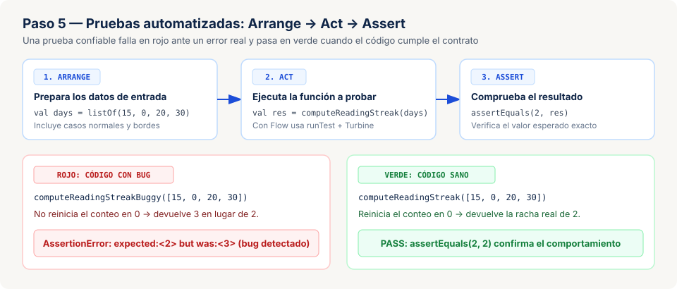

# Paso 5. Pruebas automatizadas desde cero con JUnit y Turbine



## Por qué importa

En los cuatro pasos anteriores ejecutaste pruebas escritas por el curso para comprobar tu código. En [ykro/android-course](https://github.com/ykro/android-course) también vas a escribir tus propias pruebas unitarias con [JUnit 4](https://junit.org/junit4/), [Kotlin Coroutines Test](https://kotlinlang.org/api/kotlinx.coroutines/kotlinx-coroutines-test/) y [Turbine](https://github.com/cashapp/turbine).

Una prueba útil no solo pasa cuando el código está sano: también **falla en rojo** cuando alguien introduce un error. El patrón **Arrange -> Act -> Assert** ordena cada prueba en tres pasos cortos: preparas datos controlados, llamas a la función que quieres evaluar y compruebas el resultado exacto.

## Qué se construye

En [ReadingStreak.kt](../../m4-pruebas-desde-cero/src/main/kotlin/onramp/m4/ReadingStreak.kt) ya vienen dos funciones listas para usar:

- `computeReadingStreak(dailyMinutes)`: versión sana que devuelve la racha más larga de días seguidos con lectura (`minutos > 0`) y reinicia el conteo cuando aparece un `0` o un número negativo.
- `computeReadingStreakBuggy(dailyMinutes)`: versión con un error plantado que olvida reiniciar el conteo cuando llega un día en `0`.

Tu tarea está en [ReadingStreakStudentTest.kt](../../m4-pruebas-desde-cero/src/test/kotlin/onramp/m4/ReadingStreakStudentTest.kt). Reemplaza los tres `fail(...)` por pruebas reales:

1. **Caso normal (`CA-5.1`):** pasa una lista con varias rachas separadas por un `0` (por ejemplo `listOf(15, 20, 0, 30, 25, 10)`) y verifica con `assertEquals(3, computeReadingStreak(dailyMinutes))`.
2. **Caso borde (`CA-5.2`):** verifica que `computeReadingStreak` devuelve `0` para una lista vacía (`emptyList()`) y para días en `0` (`listOf(0, 0, 0)`).
3. **Prueba que detecta el bug (`CA-5.3`):** elige una entrada donde un `0` corte la racha (por ejemplo `listOf(15, 0, 20, 30)`), verifica que `computeReadingStreak` devuelve `2` (verde) y confirma con `assertThrows(AssertionError::class.java) { assertEquals(2, computeReadingStreakBuggy(dailyMinutes)) }` que la misma aserción falla contra la versión con bug (rojo).

Cuando necesites probar un `Flow` o un `StateFlow` con tiempos virtuales en `android-course`, aplica la misma estructura **Arrange -> Act -> Assert** dentro de `runTest { ... }` y `flow.test { awaitItem() }` con Turbine (como ya viste en [Module1Test.kt](../../m1-kotlin-dsl-estado/src/test/kotlin/onramp/m1/Module1Test.kt) y [Module2Test.kt](../../m2-corrutinas-y-ui/src/test/kotlin/onramp/m2/Module2Test.kt)).

## Criterios de aceptación

- `CA-5.1` [auto] Tu prueba de caso normal verifica la racha consecutiva más larga en `computeReadingStreak` siguiendo Arrange -> Act -> Assert.
- `CA-5.2` [auto] Tu prueba de casos borde verifica que una lista vacía y una lista con días en `0` devuelven `0`.
- `CA-5.3` [auto] Tu tercera prueba pasa contra `computeReadingStreak` y confirma que la misma aserción falla contra `computeReadingStreakBuggy`.

## Cómo verificar

Este paso es completamente independiente. Desde la raíz del repositorio ejecuta tus 3 pruebas y luego la verificación completa del on-ramp:

```bash
./gradlew paso5 --no-parallel
./gradlew ready --no-parallel
```

Cuando `./gradlew ready --no-parallel` termine con `14/14` pruebas en verde, estás listo para iniciar [ykro/android-course](https://github.com/ykro/android-course).
