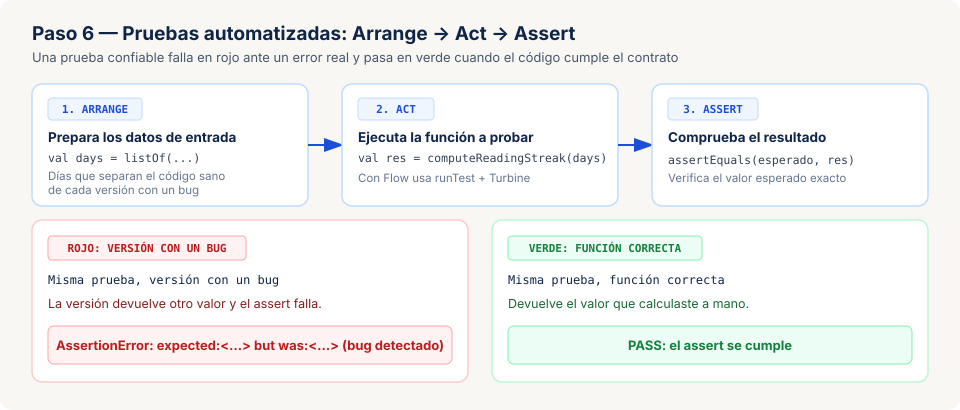

# Paso 6. Tests desde cero con JUnit



Este paso toma unos 30 minutos.

## Antes de empezar

1. Si un test pasa, ¿qué te garantiza sobre el código? ¿Y si nunca ha fallado?
2. Para una función que calcula la racha de días seguidos con lectura, ¿qué listas de entrada probarías primero?
3. ¿Cómo comprobarías que tus tests detectan un error sin romper a propósito la función real?

## Por qué importa

En los pasos anteriores corriste tests que escribió el curso. En [android-course](https://github.com/ykro/android-course) también escribes los tuyos con [JUnit 4](https://junit.org/junit4/), y en CI corren en cada push. Un test útil sigue el patrón Arrange, Act, Assert (preparar, ejecutar, comprobar) y, sobre todo, se pone en rojo cuando el código tiene un bug. Un test que pasa siempre no protege nada. Por eso aquí tus tests se corren también contra dos versiones con un bug de la misma función.

## Lo mínimo que necesitas saber

- **Un test en JUnit 4.** Es una función con `@Test` dentro de una clase de prueba. Si termina sin errores, pasa. Si un `assertEquals(esperado, real)` no se cumple, lanza `AssertionError` y el test sale en rojo con los dos valores.
- **`@Ignore`.** Salta el test. Los tres tests de este paso vienen con `@Ignore` para que no fallen antes de que los escribas.
- **Nombres con espacios.** En Kotlin puedes nombrar un test entre comillas invertidas, por ejemplo ``fun `racha vacía devuelve cero`()``. Así el reporte se lee como una oración.
- **Qué vas a ver en la consola.** `./gradlew paso6` corre tus tests tres veces. La primera, contra la función correcta, todo debe salir en verde. Las otras dos, contra cada versión con un bug, ahí sí quieres ver `FAILED` y el aviso `There were failing tests`. Al final, el verificador imprime una línea `[OK]` o `[X]` por criterio.

## Qué vas a hacer

- **Leer.** Abre [ReadingStreak.kt](../../paso6-pruebas-desde-cero/src/main/kotlin/onramp/paso6/ReadingStreak.kt) y escribe en papel qué debería devolver con tres o cuatro listas distintas, incluyendo una vacía y una con números negativos.
- **Debuguear.** Corre `./gradlew paso6 --no-parallel` con el archivo como viene. Lee por qué falla aunque ningún test sale en rojo.
- **Escribir.** Completa los tres tests de [ReadingStreakStudentTest.kt](../../paso6-pruebas-desde-cero/src/test/kotlin/onramp/paso6/ReadingStreakStudentTest.kt) y quita cada `@Ignore`. Llama siempre a `computeReadingStreak`; el verificador se encarga de cambiarla por cada versión con un bug, que están en `src/versionA/` y `src/versionB/`.

## Criterios de aceptación

- `CA-6.1` `ReadingStreakStudentTest.kt` tiene al menos tres tests y todos pasan contra la función correcta. Cada test llama a `computeReadingStreak` y comprueba el resultado con un `assert`.
- `CA-6.2` Al menos un test falla con `versionA`.
- `CA-6.3` Al menos un test falla con `versionB`.

## Al terminar

1. Escribe un test que pase con la función correcta y también con las dos versiones con un bug. ¿Qué tiene de débil?
2. Imagina una tercera versión con un bug que devuelve la racha actual al final de la lista en lugar de la más larga. ¿Qué lista usarías para atraparla?
3. Explica en tres líneas, con tus palabras, qué cambiaste y por qué. Si no puedes, vuelve a la pista 1 antes de seguir.

## Cómo verificar

```bash
./gradlew paso6 --no-parallel
./gradlew readyU1 --no-parallel
./gradlew ready --no-parallel
```

Si te trabas, abre la [pista 1](hints/1.md). Cada pista da un poco más que la anterior; la pista 3 trae un esqueleto, nunca la respuesta completa.

## Respuestas de autoevaluación («Al terminar»)

1. Por ejemplo, `assertEquals(3, computeReadingStreak(listOf(10, 20, 30)))`. Sin ceros ni negativos, las tres versiones dan lo mismo; el test pasa siempre y no detecta nada.
2. Una lista donde la racha más larga quede al principio y la última sea más corta, como `listOf(10, 20, 30, 0, 5)`. La correcta devuelve `3` y esa versión devolvería `1`.
3. Respuesta personal. Debe mencionar Arrange, Act, Assert, el caso normal, los edge cases y los datos raros, y que un test útil se pone en rojo cuando la función tiene un bug.
